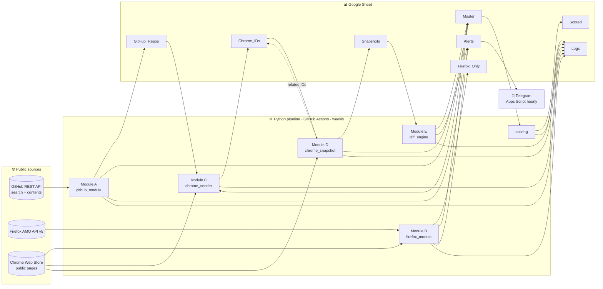
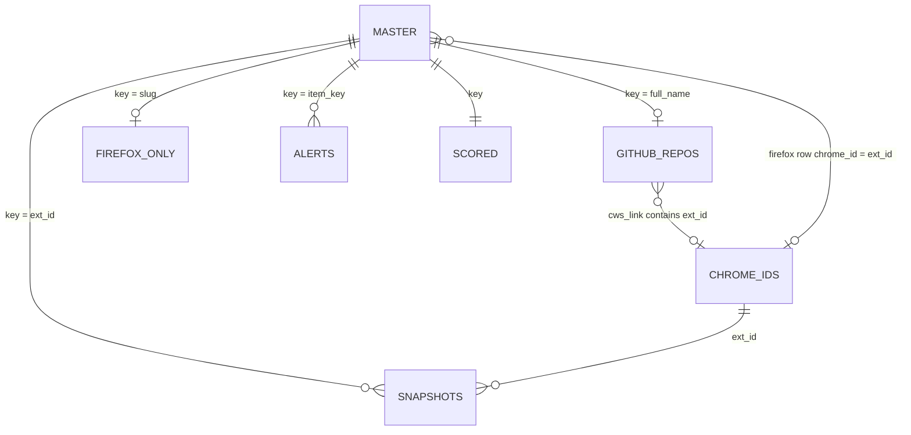

<div align="center">

# 🛰️ Extension Opportunity Radar

**Chrome extension rebuild ও flip করার সুযোগ খুঁজে বের করার একটা automated, zero-cost data pipeline**


</div>

---

## 📌 TL;DR (AI বা নতুন পাঠকের জন্য)

> এই repo একটা **weekly data pipeline**। এটা তিনটা public উৎস থেকে browser extension এর data সংগ্রহ করে: **GitHub REST API**, **Firefox Add-ons (AMO) API v5**, আর **Chrome Web Store এর public page**। তারপর সপ্তাহে সপ্তাহে কী বদলাইছে সেটা ধরে, প্রতিটা item কে score করে, আর সব কিছু একটা **Google Sheet** এ রাখে (৮টা tab)। নতুন সুযোগ পাওয়া গেলে **Telegram** এ alert যায়।
>
> লক্ষ্য হলো এমন extension খুঁজে বের করা যেগুলা: (১) open source কিন্তু পরিত্যক্ত এবং এখনো Manifest V2 তে, (২) Chrome থেকে সরানো হইছে কিন্তু মানুষ এখনো খুঁজতেছে, অথবা (৩) বিক্রি হয়ে খারাপ হয়ে গেছে, যার একটা clean বিকল্প বানানো যায়।
>
> **এটা শুধু research/data collection tool।** কোনো extension এর code, নাম বা logo কপি করা এর কাজ না।

---

## 📑 সূচিপত্র

1. [কোন সুযোগ খোঁজা হয়](#-কোন-সুযোগ-খোঁজা-হয়)
2. [Architecture](#️-architecture)
3. [Data sources ও কীভাবে সংগ্রহ হয়](#-data-sources-ও-কীভাবে-সংগ্রহ-হয়)
4. [Google Sheet schema (প্রতিটা tab ও column)](#-google-sheet-schema)
5. [Flag glossary](#-flag-glossary)
6. [Scoring](#-scoring)
7. [Write semantics: dedup, upsert, append](#-write-semantics)
8. [Telegram alert](#-telegram-alert)
9. [Scraping নীতি ও guardrails](#️-scraping-নীতি-ও-guardrails)
10. [Repo structure](#-repo-structure)
11. [Config reference](#️-config-reference)
12. [Setup guide](#-setup-guide)
13. [চালানো](#️-চালানো)
14. [Known limitations](#️-known-limitations)
15. [Sheet data দিয়ে analysis করার টিপস](#-sheet-data-দিয়ে-analysis-করার-টিপস)

---

## 🎯 কোন সুযোগ খোঁজা হয়

| # | সুযোগের ধরন | কী সংকেত খোঁজা হয় | কোন module | কোন tab এ দেখবেন |
|---|---|---|---|---|
| 1 | **Open Source Fork** | GitHub এ 300+ star, অনেকদিন push হয়নি বা archived, MIT/Apache license, `manifest.json` এ `manifest_version: 2` | A: GitHub | `GitHub_Repos`, `Alerts` (`MV2_FORK`) |
| 2 | **MV2 Graveyard** | Chrome Web Store থেকে সরানো জনপ্রিয় extension, আর Firefox এ জনপ্রিয় কিন্তু Chrome এ নাই এমন add-on | B: Firefox, D: Snapshot, E: Diff | `Firefox_Only`, `Snapshots` (`status=removed`), `Alerts` (`FIREFOX_ONLY`, `REMOVED`) |
| 3 | **Clean Alternative** | Rating হঠাৎ পড়া, developer বদল (বিক্রির সংকেত), দীর্ঘদিন update নাই কিন্তু অনেক user | D: Snapshot, E: Diff | `Alerts` (`RATING_DROP`, `DEV_CHANGE`, `STALE`) |

---

## 🏗️ Architecture



### Weekly run এর ক্রম

`github → firefox → snapshot → diff → scoring` (প্রতি **সোমবার 03:00 UTC**, অথবা হাতে চালানো যায়)

| ধাপ | কী করে | মোটামুটি সময় |
|---|---|---|
| `github` | ৩টা search query চালায়, প্রতিটা repo তে `manifest.json` আর README পড়ে | ~4 মিনিট |
| `firefox` | AMO থেকে top 500 add-on আনে, প্রতিটা নাম দিয়ে Chrome Web Store এ search করে | ~35 মিনিট |
| `snapshot` | `Chrome_IDs` এর প্রতিটা ID এর store page পড়ে | ID প্রতি ~4.5 সেকেন্ড (1000 ID ≈ 75 মিনিট) |
| `diff` | সর্বশেষ snapshot কে আগেরটার সাথে তুলনা করে | কয়েক সেকেন্ড |
| `scoring` | `Master` এর সব item score করে | কয়েক সেকেন্ড |
| `seed` | **default run এ নাই।** একবার হাতে চালাতে হয়, `Chrome_IDs` এর baseline বানায় | ~5 মিনিট |

---

## 🔍 Data sources ও কীভাবে সংগ্রহ হয়

### Module A: GitHub (`radar/github_module.py`)

| বিষয় | বিস্তারিত |
|---|---|
| **API** | GitHub official REST API: `/search/repositories`, `/repos/{repo}/git/trees/{branch}?recursive=1`, `/repos/{repo}/contents/{path}`, `/repos/{repo}/readme` |
| **Auth** | `GITHUB_TOKEN` (Actions এ নিজে থেকেই থাকে) |
| **Query** | `config/queries.yaml` → `github.queries`। Default: `topic:chrome-extension stars:>300 pushed:<2024-10-01 license:mit`, একই query `license:apache-2.0` দিয়ে, আর `topic:browser-extension stars:>300 archived:true` |
| **manifest_version কীভাবে বের হয়** | পুরা repo tree থেকে সব `manifest.json` খুঁজে। `node_modules`/`test` বাদ দেয়, কম গভীরের ফাইল আগে দেখে, আর `firefox/`, `safari/` folder এর manifest পরে দেখে। প্রথম ৩টা ফাইল থেকে regex দিয়ে `"manifest_version": N` বের করে |
| **CWS link** | README থেকে regex দিয়ে `chrome.google.com/webstore/detail/...` বা `chromewebstore.google.com/detail/...` link নেয় |
| **Rate limit** | Search: query এর মাঝে 2.5 সেকেন্ড (30 req/min)। Core API: 0.3 সেকেন্ড। 403/429 আসলে `Retry-After` বা `X-RateLimit-Reset` মেনে চলে |
| **Unique key** | `full_name` (যেমন `owner/repo`) |

### Module B: Firefox (`radar/firefox_module.py` + `radar/chrome_search.py`)

| বিষয় | বিস্তারিত |
|---|---|
| **API** | `https://addons.mozilla.org/api/v5/addons/search/?sort=users&type=extension&app=firefox` |
| **কয়টা** | `firefox.max_addons` (default 500), পেজ প্রতি 50 |
| **যা নেয়** | name, slug, users (`average_daily_users`), rating, rating_count, last_updated, category, license (`current_version.license.slug`), summary |
| **Chrome এ আছে কিনা** | নামের মূল অংশ দিয়ে (যেমন `"NordVPN - a VPN..."` থেকে `"NordVPN"`) Chrome Web Store এর search page আনে, আর প্রথম 10টা result এর সাথে নাম মিলায় |
| **Match logic** | হুবহু মূল নাম মিললে, অথবা এক নামের সব শব্দ অন্য নামে থাকলে match। একটা শর্ত আছে: বাড়তি শব্দটা অন্য নামেও থাকতে হবে, অথবা `generic_words` এ থাকতে হবে। নামে "Lite"/"MV3" থাকলে কখনো match না। এর বাইরে `difflib` ratio ≥ 0.88 হলে match |
| **ফলাফল** | `chrome_check` = `found` / `not_found` / `unknown`। শুধু `not_found` গুলা `Firefox_Only` tab এ যায় |
| **Unique key** | `slug` |

### Module C: Chrome Seeder (`radar/chrome_seeder.py`)

`Chrome_IDs` tab এ track করার মতো extension ID জোগাড় করে। এটা একবার চালাতে হয়, পরে মাঝে মাঝে।

| উৎস (`source` column এ যা লেখা থাকে) | কোথা থেকে |
|---|---|
| `github_readme` | `GitHub_Repos.cws_link` থেকে পাওয়া ID |
| `firefox_match` | Firefox module যেসব Chrome ID এর সাথে match পাইছে (`Master.chrome_id`) |
| `category:<slug>` | 18টা Chrome Web Store category page (প্রতিটা থেকে ~32টা ID) |
| `search:<keyword>` | `chrome.seed_keywords` এর 40টা keyword search |
| `related:<parent_id>` | Module D প্রতিটা detail page এর "related extensions" থেকে নতুন ID যোগ করে (run প্রতি সর্বোচ্চ 300টা) |

মোট ID কখনো `chrome.max_ids` (2000) পার হবে না।

### Module D: Weekly Snapshot (`radar/chrome_snapshot.py`)

| বিষয় | বিস্তারিত |
|---|---|
| **URL** | `https://chromewebstore.google.com/detail/{id}?hl=en` (redirect follow করে) |
| **যা নেয়** | name (`<title>` থেকে), users (`"7,000,000 users"`), rating (`"4.3 out of 5"`), rating_count (`"13.3K ratings"` থেকে 13300), version, last_updated (ISO `YYYY-MM-DD`), developer আর `developer_id` (publisher link এর `data-publisher-id`) |
| **Removed চেনা** | সরানো extension এর page HTTP 200 দেয়, কিন্তু redirect হয় `/detail/empty-title/{id}` এ। এই marker দেখলে `status=removed` |
| **Status মান** | `ok` · `removed` · `parse_error` (page আসছে কিন্তু field পাওয়া যায়নি) · `fetch_error` (retry শেষেও আনা যায়নি) |
| **Canary** | Run শুরুর আগে Dark Reader (`eimadpbcbfnmbkopoojfekhnkhdbieeh`) parse করে দেখে। ব্যর্থ হলে পুরা run থামে, ভুল data লেখা হয় না |
| **Unique key** | `snapshot_key` = `YYYY-MM-DD:<ext_id>` |

### Module E: Diff Engine (`radar/diff_engine.py`)

`Snapshots` এর সর্বশেষ তারিখের প্রতিটা row কে ওই ID এর আগের ব্যবহারযোগ্য snapshot এর সাথে তুলনা করে। আগের snapshot হিসেবে সবচেয়ে নতুন `ok` বা `removed` row নেয়, তাই কোনো সপ্তাহে fetch error হলে পরিবর্তন হারায় না। কোন flag কখন দেয় সেটা [Flag glossary](#-flag-glossary) তে আছে।

---

## 📊 Google Sheet schema

> **সব timestamp UTC, ISO 8601 format এ** (`2026-10-24T13:15:52+00:00`)। Date গুলা `YYYY-MM-DD`। প্রতিটা tab এর **প্রথম column হলো unique key**।

### Tab overview

| Tab | কে লেখে | লেখার ধরন | Unique key | কী আছে |
|---|---|---|---|---|
| `Master` | A, B, D, E | upsert | `key` | সব উৎসের সব item এর সর্বশেষ অবস্থা, এক জায়গায় |
| `GitHub_Repos` | A | upsert | `full_name` | GitHub extension repo এর পুরা তথ্য |
| `Firefox_Only` | B | upsert | `slug` | Firefox এ আছে কিন্তু Chrome এ পাওয়া যায়নি এমন add-on |
| `Chrome_IDs` | C, D | insert-only | `ext_id` | কোন Chrome extension গুলা track হচ্ছে |
| `Snapshots` | D | append-only | `snapshot_key` | Chrome extension এর সপ্তাহভিত্তিক history |
| `Alerts` | A, B, E (+ Apps Script) | insert-only | `alert_key` | Flag পাওয়া item, Telegram এর queue |
| `Scored` | scoring | upsert (manual column রক্ষা করে) | `key` | Auto score + আপনার manual যাচাই |
| `Logs` | সব module | append-only | none | প্রতিটা run এর হিসাব |

### `Master`: সব item এর এক জায়গার view

| Column | Type | অর্থ |
|---|---|---|
| `key` | string | GitHub: `owner/repo` · Firefox: `slug` · Chrome: 32 অক্ষরের extension ID |
| `source` | enum | `github` · `firefox` · `chrome` |
| `name` | string | Repo/extension এর নাম |
| `url` | url | GitHub repo / AMO page / Chrome Web Store page |
| `users_or_stars` | int | GitHub: **stars** · Firefox: daily users · Chrome: users (removed হলে আগের মান থেকে যায়) |
| `rating` | float | 0-5 (GitHub এ খালি) |
| `last_updated` | datetime/date | GitHub: শেষ push · Firefox/Chrome: শেষ update |
| `license` | string | SPDX id, lowercase (`mit`, `apache-2.0`, `gpl-3.0-only` …)। Chrome এ খালি |
| `manifest_version` | int | শুধু GitHub: `2` / `3` / খালি (পাওয়া যায়নি) |
| `flags` | csv | GitHub: `MV2`, `ARCHIVED` · Firefox: `FIREFOX_ONLY`, `CHROME_UNKNOWN` · Chrome: `REMOVED`, `RATING_DROP`, `DEV_CHANGE`, `STALE` (প্রতিটা diff এ নতুন করে লেখা হয়) |
| `first_seen` | datetime | Pipeline প্রথম কবে item টা দেখছে |
| `last_seen` | datetime | সর্বশেষ কবে দেখছে |
| `chrome_id` | string | শুধু Firefox row: যে Chrome extension এর সাথে match হইছে তার ID |

### `GitHub_Repos`: Module A এর output

| Column | Type | অর্থ |
|---|---|---|
| `full_name` | string | `owner/repo` (key) |
| `name` | string | Repo এর নাম |
| `url` | url | GitHub URL |
| `stars` / `forks` / `open_issues` | int | GitHub এর counter |
| `last_push` | datetime | সর্বশেষ push |
| `license` | string | SPDX id lowercase (`noassertion` মানে GitHub license চিনতে পারেনি) |
| `archived` | bool | `TRUE` মানে maintainer repo বন্ধ করে দিছে |
| `description` | string | Repo description (500 অক্ষর পর্যন্ত) |
| `manifest_version` | int | `manifest.json` থেকে বের করা মান |
| `manifest_path` | string | কোন `manifest.json` ফাইল থেকে পড়া হইছে |
| `cws_link` | url | README তে পাওয়া Chrome Web Store link (থাকলে) |
| `error` | string | Enrich করতে সমস্যা হলে তার বিবরণ (row টা তবুও থাকে) |
| `first_seen` / `last_seen` | datetime | প্রথম/শেষ দেখা |

### `Firefox_Only`: Module B এর output

| Column | Type | অর্থ |
|---|---|---|
| `slug` | string | AMO slug (key) |
| `name` / `url` | string / url | Add-on এর নাম আর AMO link |
| `users` | int | Average daily users |
| `rating` / `rating_count` | float / int | AMO rating |
| `last_updated` | datetime | শেষ update |
| `category` | csv | AMO category slug (`privacy-security` …) |
| `license` | string | SPDX slug lowercase |
| `description` | string | Summary |
| `chrome_check` | enum | এই tab এ সবসময় `not_found` |
| `chrome_match` | string | `closest: <সবচেয়ে কাছের Chrome নাম> (<similarity>)`। **Manual যাচাই এর জন্য এটা দেখবেন** |
| `first_seen` / `last_seen` | datetime | প্রথম/শেষ দেখা |

### `Chrome_IDs`: track করা Chrome extension এর তালিকা

| Column | Type | অর্থ |
|---|---|---|
| `ext_id` | string | 32 অক্ষরের ID (`a`-`p`) (key) |
| `name` | string | Seed করার সময়ের নাম (related ID এর জন্য খালি) |
| `source` | string | `github_readme` · `firefox_match` · `category:<slug>` · `search:<keyword>` · `related:<parent_id>` |
| `first_seen` | datetime | কবে যোগ হইছে |
| `active` | bool | `FALSE` করে দিলে snapshot আর ওই ID নিবে না (হাতে বদলানো যায়) |

### `Snapshots`: Chrome এর সপ্তাহভিত্তিক history

| Column | Type | অর্থ |
|---|---|---|
| `snapshot_key` | string | `YYYY-MM-DD:<ext_id>` (key) |
| `date` | date | Snapshot এর তারিখ |
| `ext_id` | string | Extension ID |
| `name` | string | Store এ দেখানো নাম |
| `users` | int | User সংখ্যা ("10,000+" হলে 10000) |
| `rating` | float | 0-5 |
| `rating_count` | int | মোট rating সংখ্যা |
| `last_updated` | date | Store এ দেখানো শেষ update |
| `version` | string | Version |
| `developer` | string | Publisher এর নাম |
| `status` | enum | `ok` · `removed` · `parse_error` · `fetch_error` |
| `developer_id` | string | Publisher ID (নাম বদলালেও এটা একই থাকে) |
| `error` | string | `parse_error`/`fetch_error` হলে কারণ |

### `Alerts`: flag পাওয়া item, Telegram এর queue

| Column | Type | অর্থ |
|---|---|---|
| `alert_key` | string | `<FLAG>:<item_key>`, অথবা event flag এর জন্য `<FLAG>:<item_key>:<date>` (key) |
| `flag_type` | enum | `MV2_FORK` · `FIREFOX_ONLY` · `REMOVED` · `RATING_DROP` · `DEV_CHANGE` · `STALE` |
| `date` | date | কবে flag হইছে |
| `source` | enum | `github` · `firefox` · `chrome` |
| `item_key` | string | `Master.key` এর সাথে মিলে |
| `name` | string | Item এর নাম |
| `users` | int | Firefox/Chrome: users · GitHub: stars |
| `link` | url | Item এর page |
| `sent` | bool | Telegram এ পাঠানো হলে `TRUE` (Apps Script লেখে) |
| `sent_at` | datetime | কখন পাঠানো হইছে |
| `detail` | string | কী বদলাইছে, যেমন `4.5 -> 3.9`, `Acme -> Shady Corp`, `updated 2025-04-01 (19 months)` |

### `Scored`: auto score আর manual যাচাই

| Column | কে পূরণ করে | অর্থ |
|---|---|---|
| `key`, `source`, `name`, `link` | script | `Master` থেকে আসে |
| `users_10k_plus` | script | `yes` / `no` / `unknown` / `n/a (stars)` (GitHub এ users নাই) |
| `signal_flags` | script | `STALE`, `REMOVED`, `RATING_DROP` এর মধ্যে যেগুলা আছে |
| `license` | script | SPDX id |
| `license_ok` | script | `yes` (permissive বা copyleft) · `no` · `unknown` · `n/a` (Chrome store item) |
| `license_note` | script | GPL হলে মনে করিয়ে দেয়: নিজের version ও open source রাখতে হবে |
| `auto_score` | script | 0-3 ([Scoring](#-scoring) দেখুন) |
| `last_scored` | script | কবে score হইছে |
| `manual_one_week_build` | **আপনি** | এক সপ্তাহে বানানো যায়? |
| `manual_no_heavy_backend` | **আপনি** | Heavy backend বা paid API লাগে না? |
| `manual_not_builtin_chrome` | **আপনি** | Chrome নিজে এই feature এখনো built-in করে নাই? |
| `manual_keyword_search` | **আপনি** | Keyword এ এখনো search হয়? |
| `manual_notes` | **আপনি** | যেকোনো note |

> `manual_*` column গুলা script কখনো overwrite করে না।

### `Logs`: প্রতিটা run এর হিসাব

| Column | অর্থ |
|---|---|
| `run_at` | Run শুরুর সময় (UTC) |
| `module` | `github` · `firefox` · `chrome_seeder` · `chrome_snapshot` · `diff_engine` · `scoring` |
| `processed` | কয়টা item process হইছে |
| `errors` | কয়টা item এ error হইছে |
| `duration_sec` | কত সেকেন্ড লাগছে |
| `note` | Summary, যেমন `{'ok': 900, 'removed': 78}; 300 related ids added`, অথবা `FAILED: ...` |

### Tab গুলা কীভাবে একসাথে যুক্ত



---

## 🚩 Flag glossary

| Flag | Source | কখন হয় | Alert কতবার যায় |
|---|---|---|---|
| `MV2_FORK` | github | `manifest_version == 2` এবং license `permissive_licenses` বা `copyleft_licenses` এর মধ্যে | item প্রতি একবার |
| `MV2` / `ARCHIVED` | github | শুধু `Master.flags` এ থাকে, তথ্য হিসেবে | alert হয় না |
| `FIREFOX_ONLY` | firefox | Chrome এ match পাওয়া যায়নি, আর users ≥ `alerts.firefox_only_min_users` (10K) | item প্রতি একবার |
| `CHROME_UNKNOWN` | firefox | Chrome search fail করছে, অথবা canary ভাঙছে | alert হয় না |
| `REMOVED` | chrome | আগের snapshot এ `ok`, এখন `removed` | প্রতিবার ঘটলে |
| `RATING_DROP` | chrome | আগের rating থেকে এখনকার rating ≥ `diff.rating_drop_threshold` (0.5) কম | প্রতিবার ঘটলে |
| `DEV_CHANGE` | chrome | `developer_id` বা developer এর নাম বদলাইছে | প্রতিবার ঘটলে |
| `STALE` | chrome | `last_updated` 12-24 মাস আগে এবং users > 10K | item প্রতি একবার |

> `REMOVED`, `RATING_DROP` আর `DEV_CHANGE` এর জন্য **কমপক্ষে দুই সপ্তাহের snapshot** লাগে। প্রথম snapshot এর পর শুধু `STALE` আসতে পারে।

---

## 🧮 Scoring

`auto_score` = নিচের তিনটা চেকের যে কয়টা সত্য (0-3):

1. `users_10k_plus == yes`
2. `signal_flags` খালি না (`STALE` / `REMOVED` / `RATING_DROP`)
3. `license_ok` হলো `yes` বা `n/a`

`auto_score` শুধু প্রথম filter। চূড়ান্ত সিদ্ধান্ত নেওয়া হয় `manual_*` column গুলা দিয়ে।

---

## ✍️ Write semantics

| ধরন | কোন tab | আচরণ |
|---|---|---|
| **upsert** | `Master`, `GitHub_Repos`, `Firefox_Only`, `Scored` | Key মিললে row update হয়, না মিললে নতুন row। নতুন dict এ যে column নাই সেগুলা আগের মতো থাকে, তাই manual column রক্ষা পায়। `first_seen` শুধু প্রথমবার লেখা হয়, `last_seen` প্রতিবার |
| **insert-only** | `Alerts`, `Chrome_IDs` | Key আগে থেকে থাকলে কিছু করে না, তাই `sent` status কখনো reset হয় না |
| **append-only** | `Snapshots`, `Logs` | `Snapshots` শুধু key column পড়ে duplicate এড়ায়, তাই tab বড় হলেও দ্রুত চলে |

সব value `RAW` mode এ লেখা হয়, তাই কোনো description `=` দিয়ে শুরু হলেও সেটা formula হিসেবে চলে না।

---

## 📱 Telegram alert

`apps_script/telegram_alert.gs` Sheet এর ভেতরে Google Apps Script হিসেবে চলে।

1. প্রতি ঘণ্টায় `sendNewAlerts()` চলে (time trigger)
2. `Alerts` tab এর যেসব row এ `sent != TRUE`, সেগুলা পড়ে
3. Message বানায়: প্রতিটা flag এ কয়টা item, আর প্রতিটা flag এর **top 5** (users অনুযায়ী) item এর name, users, link আর detail
4. পাঠানোর পর ওই row গুলাতে `sent = TRUE` আর `sent_at` লেখে

Bot token আর chat ID থাকে **Script Properties** এ (`TELEGRAM_BOT_TOKEN`, `TELEGRAM_CHAT_ID`), code এ না।

---

## 🛡️ Scraping নীতি ও guardrails

Chrome Web Store এর কোনো official API নাই, তাই এর public page পড়তে হয়। এই নিয়মগুলা মানা হয়:

| Guardrail | কীভাবে |
|---|---|
| **সপ্তাহে একবার** | `firefox` আর `snapshot` দুইটাই `Logs` দেখে। গত 6 দিনে চললে নিজে থেকেই skip করে (`--force` দিলে guard ignore হয়) |
| **Random delay** | প্রতিটা request এর আগে 2-5 সেকেন্ড |
| **Exponential backoff** | 2, 4, 8, 16 সেকেন্ড, সর্বোচ্চ 4 বার retry। 429/5xx/rate-limit এ retry করে |
| **Defensive parser** | কোনো row parse না হলে ওই row এ `parse_error` লিখে বাকিগুলা চালায় |
| **Canary** | Search আর detail দুইটার জন্যই একটা জানা extension দিয়ে আগে test করে। HTML বদলে গেলে ভুল data না লিখে থামে |
| **Batch write** | প্রতি 100টা snapshot পর পর Sheet এ লেখে, তাই crash হলেও data হারায় না |
| **Secret** | Log এ token mask করা হয়। Secret শুধু GitHub Secrets আর লোকাল `.env` এ থাকে (gitignore করা) |

---

## 📁 Repo structure

```
.
├── CLAUDE.md                 # Project এর নিয়ম, context আর current status (AI assistant এর জন্য)
├── README.md
├── requirements.txt          # requests, gspread, google-auth, PyYAML, python-dotenv, pytest
├── .env.example              # লোকাল env var এর template
├── config/
│   └── queries.yaml          # সব query, threshold, delay, limit, category, keyword
├── radar/
│   ├── main.py               # Pipeline runner (--only, --force)
│   ├── github_module.py      # Module A
│   ├── firefox_module.py     # Module B
│   ├── chrome_search.py      # CWS search parser + name matching (B, C ব্যবহার করে)
│   ├── chrome_seeder.py      # Module C
│   ├── chrome_snapshot.py    # Module D
│   ├── diff_engine.py        # Module E
│   ├── scoring.py            # Scored tab
│   ├── sheets.py             # Tab schema (TABS) + upsert/append helper
│   └── utils.py              # config, logging (secret mask), retry/backoff, delay
├── scripts/
│   └── setup_sheet.py        # সব tab আর header বানায় (আবার চালালেও data মুছে না)
├── apps_script/
│   └── telegram_alert.gs     # Telegram alert (Sheet এর Apps Script)
├── .github/workflows/
│   └── radar.yml             # Weekly cron + manual dispatch
└── tests/                    # pytest। সব network call mock করা, in-memory fake Sheet
```

> **Tab এর schema এর একমাত্র উৎস হলো `radar/sheets.py` এর `TABS`।** README আর code এর মধ্যে অমিল থাকলে code টাই ঠিক।

---

## ⚙️ Config reference

সব কিছু `config/queries.yaml` এ, code এ কোনো মান hardcode করা নাই।

| Key | Default | কাজ |
|---|---|---|
| `github.queries` | 3টা query | GitHub search query |
| `github.max_repos` | 1000 | এক run এ সর্বোচ্চ কয়টা repo enrich করবে |
| `firefox.max_addons` | 500 | Top কয়টা Firefox add-on চেক করবে |
| `firefox.min_days_between_runs` | 6 | Firefox/CWS search guard |
| `chrome_search.match_threshold` | 0.88 | নাম কতটা মিললে "Chrome এ আছে" ধরবে |
| `chrome_search.variant_words` | lite, mv3, light | এই শব্দ থাকলে আলাদা product ধরা হয় |
| `chrome_search.generic_words` | standard, pro, free … | যে বাড়তি শব্দ থাকলেও একই product ধরা হয় |
| `chrome_search.delay_min/max_seconds` | 2 / 5 | CWS request এর মাঝে random delay |
| `chrome.max_ids` | 2000 | সর্বোচ্চ কয়টা Chrome ID track করবে |
| `chrome.min_days_between_runs` | 6 | Snapshot guard |
| `chrome.max_new_related_per_run` | 300 | প্রতি run এ related থেকে কয়টা নতুন ID |
| `chrome.categories` / `seed_keywords` | 18 / 40টা | Seeder এর উৎস |
| `diff.rating_drop_threshold` | 0.5 | RATING_DROP এর সীমা |
| `diff.stale_min_months` / `stale_max_months` / `stale_min_users` | 12 / 24 / 10000 | STALE এর শর্ত |
| `scoring.min_users` | 10000 | `users_10k_plus` এর সীমা |
| `alerts.firefox_only_min_users` | 10000 | এর কম user হলে FIREFOX_ONLY alert যায় না |
| `http.max_retries` / `backoff_base_seconds` | 4 / 2 | Retry policy |

---

## 🚀 Setup guide

### 1. Local setup

```bash
python -m venv .venv
.venv\Scripts\activate          # Windows (macOS/Linux: source .venv/bin/activate)
pip install -r requirements.txt
copy .env.example .env          # macOS/Linux: cp .env.example .env
python -m pytest -q
```

### 2. Google service account

1. https://console.cloud.google.com এ নতুন project বানান। **Organization এর জায়গায় "No organization" দিন**, না হলে org policy key বানাতে দিবে না।
2. **APIs & Services → Library** থেকে **Google Sheets API** আর **Google Drive API** enable করুন।
3. **Credentials → Create credentials → Service account** এ যান (role লাগবে না)।
4. **Keys → Add key → JSON** থেকে key download করুন, আর project folder এ `service_account.json` নামে রাখুন (gitignore করা আছে)।
5. `.env` এ লিখুন: `GOOGLE_SERVICE_ACCOUNT_FILE=./service_account.json`

### 3. Google Sheet

1. https://sheets.new থেকে খালি Sheet বানান। URL এর `/d/<SHEET_ID>/edit` থেকে ID নিয়ে `.env` এ `SHEET_ID=` বসান।
2. Service account এর email (JSON এর `client_email`) কে **Editor** হিসেবে share করুন।
3. Tab বানান: `python scripts/setup_sheet.py`

### 4. GitHub token (শুধু local run এর জন্য)

https://github.com/settings/personal-access-tokens/new থেকে **Fine-grained** token বানান, "Public repositories (read-only)" দিলেই হবে। `.env` এ `GITHUB_TOKEN=` বসান। Token না দিলেও চলে, তবে search অনেক ধীর হয়।

### 5. GitHub Actions

1. Repo **public** রাখুন (তাহলে Actions free)।
2. Secrets যোগ করুন:

```powershell
Get-Content service_account.json -Raw | gh secret set GOOGLE_SERVICE_ACCOUNT_JSON
gh secret set SHEET_ID --body "<SHEET_ID>"
```

`GITHUB_TOKEN` লাগবে না, Actions নিজেই দেয়।

### 6. Telegram

1. **@BotFather** এ `/newbot` পাঠিয়ে token নিন। Bot কে একটা message পাঠান, তারপর `https://api.telegram.org/bot<TOKEN>/getUpdates` থেকে chat ID নিন।
2. Sheet এ **Extensions → Apps Script** খুলে `apps_script/telegram_alert.gs` paste করুন।
3. **Project Settings → Script Properties** এ `TELEGRAM_BOT_TOKEN` আর `TELEGRAM_CHAT_ID` বসান।
4. প্রথমে `sendTestMessage` Run করুন, তারপর একবার `installTrigger` Run করুন।

---

## ▶️ চালানো

```bash
python -m radar.main                              # weekly pipeline: github,firefox,snapshot,diff,scoring
python -m radar.main --only seed                  # Chrome ID baseline (প্রথমবার)
python -m radar.main --only snapshot,diff,scoring
python -m radar.main --force                      # সপ্তাহে-একবার guard ignore করে (সাবধানে)

python -m radar.github_module                     # প্রতিটা module আলাদাভাবেও চালানো যায়
python -m radar.firefox_module [--force]
python -m radar.chrome_seeder
python -m radar.chrome_snapshot [--force] [--limit 20]
python -m radar.diff_engine
python -m radar.scoring
```

GitHub Actions থেকে: **Actions → Extension Radar → Run workflow** (`only` আর `force` input দেওয়া যায়), অথবা:

```bash
gh workflow run radar.yml -f only=snapshot,diff,scoring
```

Exit code: সব step সফল হলে `0`। কোনো step fail করলে `1`, তবে বাকি step গুলা তবুও চলে।

---

## ⚠️ Known limitations

- **Firefox থেকে Chrome matching শুধু নাম দিয়ে হয়।** তাই কিছু ভুল থাকে:
  - Chrome এ একই নামের copycat থাকলে আসল FIREFOX_ONLY item বাদ পড়তে পারে। যেমন "uBlock Origin: Facebook, YouTube & Sites" নামের একটা copycat আছে।
  - ভিন্ন নামে থাকা extension ভুলভাবে FIREFOX_ONLY হতে পারে। যেমন NoScript, Copyfish।
  - `chrome_match` column দেখে manual যাচাই করবেন।
- **Chrome Web Store এর HTML বদলাতে পারে।** তখন canary run থামিয়ে দিবে, আর `Logs` এ `FAILED: canary ...` দেখাবে। তখন `radar/chrome_snapshot.py` এর regex গুলা আপডেট করতে হবে।
- **GitHub এর `users_or_stars` হলো star, user না।** GitHub থেকে user সংখ্যা জানার উপায় নাই। `cws_link` থাকলে `Snapshots` এ আসল Chrome users দেখা যায়।
- **`Snapshots` প্রতি সপ্তাহে বাড়ে** (≤2000 row)। Google Sheet এর limit 1 কোটি cell, তাই কয়েক বছর পর পুরানো row archive করতে হবে।
- **Search API সর্বোচ্চ 1000 result দেয়**, তাই query প্রতি এর বেশি repo আসবে না।

---

## 🔬 Sheet data দিয়ে analysis করার টিপস

| প্রশ্ন | কীভাবে বের করবেন |
|---|---|
| **কোন open source extension Chrome থেকে সরানো হইছে?** (সবচেয়ে শক্তিশালী সংকেত) | `GitHub_Repos.cws_link` থেকে ID বের করে `Snapshots` এ খুঁজুন যেখানে `status = removed` |
| পরিত্যক্ত কিন্তু এখনো জনপ্রিয় | `Snapshots`: `status = ok`, `users` বেশি, `last_updated` পুরানো, অথবা `Alerts.flag_type = STALE` |
| বিক্রি হওয়ার সন্দেহ | `Alerts.flag_type = DEV_CHANGE`, তার সাথে পরের সপ্তাহের `RATING_DROP` |
| Firefox এ আছে, Chrome এ নাই | `Firefox_Only` কে `users` দিয়ে sort করুন। `chrome_match` দেখে নিশ্চিত হন |
| একই চাহিদা দুই উৎসে দেখা যাচ্ছে | `GitHub_Repos.description` আর `Firefox_Only.name` এ একই feature খুঁজুন (vertical tabs, mouse gestures, link opener …) |
| Pipeline ঠিকমতো চলছে কিনা | `Logs` এ শেষ run এর `errors` আর `note` দেখুন |
